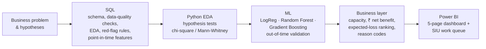
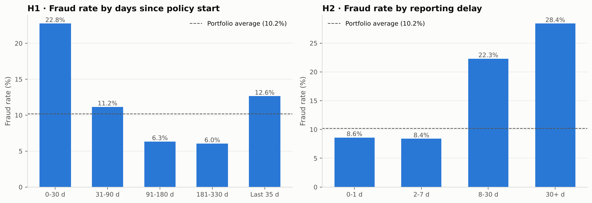
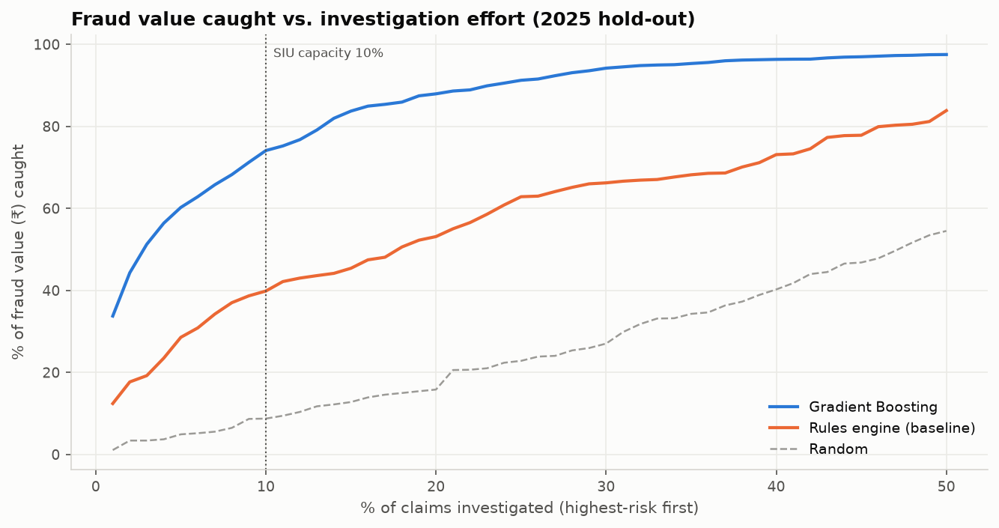
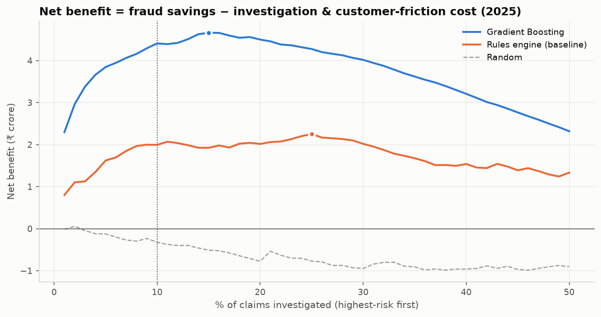
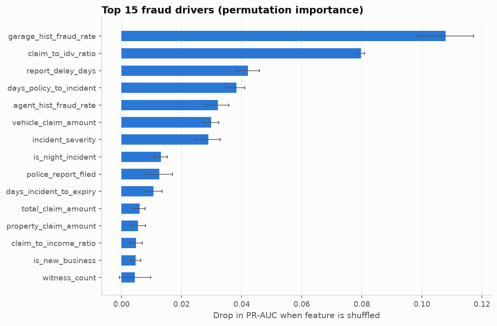

# Insurance Claims Fraud Detection: SQL · Python · Machine Learning · Power BI

> **An insurer's investigation team can only check 10% of claims. Which 10%?**
> This project replaces a rules-based red-flag system with a machine-learning priority queue. With the same team, it catches **74% of fraud value instead of 40%**, worth **≈ ₹2.4 Cr extra net benefit a year** on a 5,000-claim book.

| | Rules engine (today) | ML model (this project) |
|---|---|---|
| Fraud value caught at 10% review capacity | 39.9% | **74.1%** |
| Fraud ₹ caught (2025) | ₹4.61 Cr | **₹8.58 Cr** |
| Net benefit after investigation and customer-friction costs | ₹1.99 Cr | **₹4.41 Cr** |
| PR-AUC (ranking quality on rare fraud) | 0.236 | **0.463** |

*Evaluated on an untouched 2025 hold-out year. The model was trained on 2022–2023 and tuned on 2024.*

> **Data note: this project uses synthetic data.** Real insurance claims are confidential, so `src/generate_data.py` builds a realistic relational dataset whose fraud patterns follow known industry red flags, with deliberate noise and data-quality issues. The rupee figures show what the method delivers on that data; they are not results from a real insurer. See [§8 About the data](#8-about-the-data).

---

## 1. Business problem

A mid-size Indian motor insurer settles ~5,000 claims a year. About **10% turn out to be fraudulent**: staged accidents, padded repair bills, claims on pre-existing damage. Over four years, **₹12.7 Cr was paid out on claims later confirmed as fraud**.

The Special Investigation Unit (SIU) has capacity to investigate ~10% of claims and selects them with a **red-flag rules score**. The rules are coarse. Every flag counts equally, hundreds of claims tie on the same score, and the system ignores *who* is involved (garage, agent).

**Goal:** re-rank the investigation queue so the same team stops more fraud **value** without harassing more genuine customers.

## 2. Approach



### Hypotheses tested (all supported, p < 0.001)
| # | Hypothesis | Finding |
|---|---|---|
| H1 | Claims soon after buying a policy are riskier | 0–30-day claims: **22.8%** fraud vs 10.2% average (2.2×) |
| H2 | Late-reported claims are riskier | Reported 30+ days late: **28.4%** fraud |
| H3 | Night-time major losses without a police report are riskier | **29%** fraud, 3× the day-time, police-reported rate |
| H4 | Repeat claimants are riskier | 2+ claims in prior 12 months: **26%** fraud |
| H5 | Fraud clusters in a few garages and agents | Top 5% of garages hold **44% of garage-linked fraud value**; 8 agents run at 2–4× average |
| H6 | Fraud claims are larger relative to the vehicle's insured value | Median claim/IDV 0.16 vs 0.11 (overlapping, weak alone) |

<p align="center"></p>

## 3. Results

### Same SIU effort, about twice the fraud value caught
<p align="center"></p>

### Net benefit = fraud savings − investigation cost − friction for genuine customers
<p align="center"></p>

The model's benefit peaks at ~12–15% of claims reviewed, so a modest increase in SIU capacity still pays for itself. The curve is flat near the top, though, so the main gain comes from **re-ordering the existing queue**.

### What drives the model (and it matches the hypotheses)
<p align="center"></p>

### Model comparison (2025 hold-out)
| Model | ROC-AUC | PR-AUC | Precision @10% | Fraud cases caught @10% | Fraud value caught @10% |
|---|---|---|---|---|---|
| Rules engine (baseline) | 0.735 | 0.236 | 31.1% | 32.5% | 39.9% |
| Logistic Regression | 0.810 | 0.393 | 41.4% | 43.3% | 48.7% |
| Random Forest | 0.834 | 0.430 | 43.6% | 45.5% | 52.9% |
| Gradient Boosting | **0.849** | **0.463** | **46.5%** | **48.7%** | 56.8% |
| **Gradient Boosting, queue ranked by expected ₹ loss** (chosen) | 0.784 | 0.350 | 35.6% | 37.3% | **74.1%** |

**Key design decision:** ranking claims by *expected loss* (fraud probability × claim amount) instead of probability alone catches fewer fraud *cases* but far more fraud *value*, which is what the business cares about. Its ROC-AUC and PR-AUC are lower because the score is no longer a pure fraud probability. The choice was made on the 2024 validation year, not on the test set.

## 4. Recommendations
1. **Switch the SIU queue to the model's expected-loss ranking.** Same headcount, about twice the fraud value caught.
2. **Act on the network, not just claims.** Audit the handful of garages at 3–5× average fraud and review their cashless-network status. Tie agent commissions to confirmed-fraud outcomes.
3. **Add friction where risk is highest.** Require video inspection for claims in the first 30 days of a policy and for major losses reported late or without a police report.
4. **Grow SIU capacity modestly (to ~12–15%)** only after the re-ranking is in place.
5. **Monitor monthly** queue hit-rate and feature drift; retrain quarterly as investigations close.

## 5. Technical highlights

**SQL** (`sql/`, SQLite, portable to PostgreSQL/MySQL)
- Normalised 5-table schema with keys and indexes
- 11 automated **data-quality checks**: orphans, date logic, coverage mismatches, missing values ([report](reports/data_quality_report.md))
- 11 business queries using **CTEs, window functions (RANK, LAG, rolling averages, RANGE frames), self-joins, HAVING** ([results](reports/sql_insights.md))
- The rules engine is written as a SQL view: the baseline to beat
- **Point-in-time feature engineering:** garage and agent fraud history uses only investigations closed ≥ 90 days earlier, with Bayesian smoothing

**Machine learning** (`src/modeling.py`, `src/train_model.py`)
- **Leakage controls:** post-decision fields excluded and asserted; history features lagged; **out-of-time split** (train 2022–23 → validate 2024 → test 2025)
- Imbalanced-data metrics: PR-AUC, precision and recall at fixed capacity, value-weighted recall. Class weighting was tested and rejected because it hurt ranking and calibration.
- Hyper-parameter grid selected on validation; the test set was scored **once**
- **Explainability:** permutation importance plus plain-English **reason codes** for each flagged claim
- **Cost-benefit model** with explicit, adjustable assumptions (`COST_PER_INVESTIGATION`, `RECOVERY_RATE`, `FALSE_POSITIVE_FRICTION`)

**Power BI** (`powerbi/Insurance_Fraud_Dashboard.pbip`)
- Power BI Project generated from code by `src/build_powerbi_project.py` (TMDL semantic model + PBIR report), so the dashboard is version-controlled like the rest of the code
- Star schema (1 fact table, 4 dimensions, Date table), 35 DAX measures, including rolling, YoY and RANKX measures
- **What-if parameters** so stakeholders can stress-test the business case live (at a 40% recovery rate the model still beats the rules: ₹2.69 Cr vs ₹1.07 Cr)
- 5 pages: Executive Overview · Fraud Patterns · Garage & Agent Network · Model Impact · SIU Investigation Queue
- Headline measures reconcile with `reports/model_results.json`; the [dashboard guide](powerbi/dashboard_build_guide.md) lists the checkpoint values

## 6. Repository structure
```
├── run_pipeline.py                  # one command: data -> SQL -> model -> Power BI export
├── sql/
│   ├── 01_schema.sql
│   ├── 02_data_quality_checks.sql
│   ├── 03_exploratory_analysis.sql
│   ├── 04_red_flag_rules.sql        # baseline rules engine (view)
│   └── 05_feature_engineering.sql   # point-in-time modelling table
├── src/
│   ├── generate_data.py             # synthetic relational dataset
│   ├── build_database.py            # runs the SQL layer, writes reports
│   ├── modeling.py                  # features, models, business metrics, reason codes
│   ├── train_model.py               # selection, evaluation, scoring
│   ├── plots.py
│   ├── export_powerbi.py            # star-schema CSVs for Power BI
│   └── build_powerbi_project.py     # generates the .pbip dashboard (model + 5 report pages)
├── notebooks/
│   ├── 01_eda_and_hypothesis_testing.ipynb
│   └── 02_fraud_model_and_business_impact.ipynb
├── reports/                         # DQ report, SQL insights, metrics, figures
├── powerbi/
│   ├── Insurance_Fraud_Dashboard.pbip            # open this in Power BI Desktop
│   ├── Insurance_Fraud_Dashboard.SemanticModel/  # tables, relationships, DAX (TMDL)
│   ├── Insurance_Fraud_Dashboard.Report/         # pages and visuals (PBIR)
│   ├── data/                                     # CSVs the dashboard loads
│   └── DAX_measures.md · dashboard_build_guide.md · fraud_dashboard_theme.json
└── data/                            # raw CSVs, SQLite DB, modelling table: created by run_pipeline.py
```

## 7. How to run
```bash
git clone https://github.com/akashchaurasiya406/Insurance-Claims-Fraud-Detection-Investigation-Prioritisation.git
cd Insurance-Claims-Fraud-Detection-Investigation-Prioritisation
python -m venv .venv && source .venv/bin/activate      # Windows: .venv\Scripts\activate
pip install -r requirements.txt
python run_pipeline.py                              # ~2 minutes: builds data/, models/, reports/ and powerbi/data/
jupyter notebook notebooks/                         # walkthrough with charts
python src/build_powerbi_project.py --set-data-folder   # tells the dashboard where powerbi/data is on this machine
```
Then open `powerbi/Insurance_Fraud_Dashboard.pbip` in Power BI Desktop and click **Refresh**. Use **File → Save as** to keep a single `.pbix` file. Details and checkpoint values are in [powerbi/dashboard_build_guide.md](powerbi/dashboard_build_guide.md).

## 8. About the data
Real claims data is confidential, and the public fraud datasets are either tiny (~1,000 rows) or fully anonymised (`V1…V28`), which rules out any business storytelling. So `src/generate_data.py` builds a **synthetic but realistic relational dataset**: 30,000 customers, 71,000 policy-years, 320 garages, 150 agents and **16,810 claims (2022–2025)**. Fraud is driven by common industry red flags, with **deliberate noise and overlapping distributions** so no rule or model is perfect. It also includes realistic data-quality issues: missing values and mis-keyed dates.

**Limitations:** labels only reflect *detected* fraud. The ₹ assumptions should be validated with claims and SIU teams. A production version would add document/image signals, claimant network graphs and model monitoring.

## Tech stack
`SQL (SQLite)` · `Python` · `pandas` · `NumPy` · `scikit-learn` · `SciPy` · `Matplotlib` · `Power BI (DAX, Power Query)` · `Jupyter`
